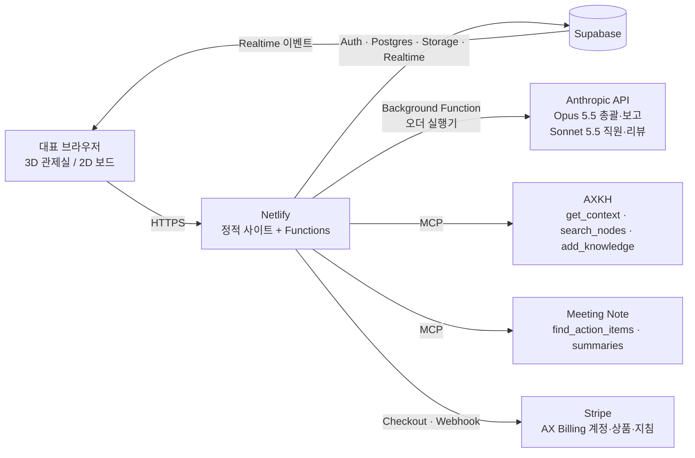

# AI 오피스 기획서 v0.1 — "총괄에게 시키면 팀이 꾸려지고, 결과물이 나오는 사무실"

작성: 2026-10-12 · 상태: 초안(대표 확인 전) · 근거: 오픈소스 지형도·시장조사·3D 기술 타당성·TecAce 회의록·AXKH 분석 (scratchpad/research/*.md)

> 표기 규칙: 근거가 있는 문장은 출처를 붙였고, 제 판단은 **(추정)**, 2차 출처라 재확인이 필요한 수치는 **(미확인)**으로 표시했습니다. AXKH의 "확실하지 않으면 단정하지 않는다" 원칙을 따랐습니다.

---

## 0. 이미 결정된 전제 (대표 답변)

| 항목 | 결정 |
|---|---|
| 1차 시장 | **미국 한인 SMB 먼저** (기존 고객·세미나 채널·AX Billing/Stripe·영어 포털 활용). 한국은 2027 바우처 파이프라인으로 후순위 |
| 수익 모델 | **구독 + 구축·컨설팅 결합** |
| 배포 형태 | **독립 웹 서비스** (Netlify + Supabase + 결제) |
| 3D 톤 | **전문적·절제된 사무실** ("유치함" 금지, 신뢰감 있는 익숙한 UI) |
| 모델 정책 | **총괄·최종 보고 = Opus 5.5, 직원 = Sonnet 5.5** |
| 데모 | **API 키 없이 보는 사람의 claude.ai 구독으로 동작** (아티팩트 v2 반영 완료) |

---

## 1. 한 줄 정의와 포지셔닝

**"AI 직원 팀을 눈으로 보며 운영하는 관제실."** 대표가 총괄에게 일을 맡기면, 총괄이 일을 나누고 역할 풀에서 직원을 뽑아 팀에 앉히고, 직원들이 결과물을 만들고, 리뷰 룸에서 다각도 검증을 거쳐, 대표가 **승인 한 번**으로 결과를 받는다. 3D 사무실은 "지금 누가 무엇을 하고, 어디서 멈췄고, 무엇이 승인을 기다리는지"를 보여주는 **관찰·승인 레이어**이지 장식이 아니다.

- TecAce 안에서의 자리: 이미 소개 자료가 있는 **Managed Agent Service(역할별 AI 직원 팀)의 "보이는 프런트엔드"**이자, Hermes 롤 베이스 실험과 Notion "Mission Control"의 후속 제품 [AXKH: 관리형 에이전트 서비스 소개 2026 / 회의: 2026-06-15 Weekly]. "우리 제품으로 우리 제품을 판다"(영업 플레이북 Play 08)의 실체.
- 메시지 뼈대는 Managed Agent Service 소개 자료의 세 가지 가치를 그대로 잇는다: **부린다**(자연어로 지시) · **알아서 한다**(스케줄대로 자율 작업·보고) · **믿고 안 샌다**(기업 지식 기준 답변·가드레일·거버넌스) [AXKH: 관리형 에이전트 서비스 소개 2026]. 도입 사다리도 같다: **Day-1** 웹 모니터링 브리핑 → **Week-2** 시스템 연결(ERP·노션·Shopify) → **Month-1** 지식 베이스 정돈·가드레일.
- 메시지 원칙(Play 01: 'AI'를 주어에서 뺀다): **"매주 반복되는 보고서·콘텐츠·리서치에 쓰는 시간을 AI 부서가 대신하고, 당신은 승인만 합니다. 지금 그 일에 몇 시간, 얼마가 들어가는지부터 보겠습니다."**
- 하지 않을 것: "직원 대체" 마케팅(Artisan식 반발), 귀여운 캐릭터로 파는 것(Sintra식 실망), 상담봇(카카오·KT와 경쟁), 콜드 아웃바운드 자동화.

### 왜 지금, 어디가 비어 있나 (리서치 종합)
- **상태 모델은 있지만 보이지 않는 제품**(Paperclip 100.9k★, MIT: 조직도·CEO·이슈 트리·승인·예산, 시각 없음)과 **보이지만 파이프라인이 없는 제품**(Claw3D·agent-office·hermes-virtual-office: 관찰 레이어만)으로 갈라져 있다. "지시 → 자동 채용/팀 편성 → 산출물 → 리뷰 → 승인"을 3D로 보여주는 제품은 조사 범위에서 없었다 [opensource.md §2-3].
- 상용 "AI 직원" 제품의 1위 불만은 **크레딧 소진·불투명 과금·실패 작업 과금** (Sintra·Genspark·Manus) → 정액 + 산출물 단위 크레딧 + **실패 무과금** + 저속 모드가 차별점 [market.md §2].
- 직접 경쟁 주의: **한컴 노마디안**(3D 룸의 AI 직원 캐릭터, 2026.12 미국 베타 → 2027 유료화, 한국은 그 다음) **(2차 출처)** → 미국 한인 SMB에서 레퍼런스를 먼저 쌓고, 한국은 바우처 창구로 들어가는 순서가 맞아 보인다 **(추정)**.
- 고객이 실제 돈을 내는 산출물: 완성 파일(보고서·슬라이드·시트), 콘텐츠 캘린더, 데이터 분석·주간 보고, 사내 문서 Q&A, **승인 루프 자체** [market.md §3].

---

## 2. 고객과 첫 주문 (근거 기반)

| 순위 | 고객 | 첫 주문(오더) | 근거 |
|---|---|---|---|
| 1 | **iKamper America** (유료 고객, 마케팅 자동화 SOW, BI 매뉴얼·로고 자산 보유) | "BI 매뉴얼대로 신제품 카드뉴스 5종 + 쇼츠 스크립트 3개 + 뉴스레터 초안(한/영), Shopify 주문 엑셀로 주간 판매 리포트" / "미·한·유럽 경쟁사 가격·업계 뉴스 주간 뉴스레터" | 회의 2026-06-15·09-18, AXKH: iKamper 제안·경쟁 모니터링 뉴스레터 |
| 2 | **Olympus Spa** (Voice Agent 첫 유료 고객, 통화·보이스메일 데이터) | "지난주 통화·보이스메일 분석 → 예약 전환율·미응답·FAQ 누락 보고 + FAQ/프롬프트 개선 초안" | 회의 2026-09-17·10-12 |
| 3 | **시애틀 회계사 사무소** | "클라이언트별 필요 서류 체크리스트 + 누락 알림 이메일 초안 + 전화 응대 요약" | 회의 2026-07-20·09-18 |
| 4 | **워싱턴주 한인기업 세미나 리드(2~3곳), 보험사(브릿지원), 서울트레이딩** | 업종별 맞춤 데모("URL만 주시면 귀사 자료로 데모") | 회의 2026-07-20, Play 08 |
| 내부 | **BLG 팀 도그푸딩**: 월간 뉴스레터, 제안서·SOW 초안, 주간 Stripe/테크스택 리서치, 회의 액션아이템→오더, CRM 팔로업 | AXKH: BLG AI Native Team / 회의 2026-10-08 |

후순위: H마트(가격 장벽·내부 구축 선회), 한국 유닉스(한국, 월 관리비 모델 실증 대상이나 결제·언어 준비 후).

---

## 3. 제품 구조 — 4-Level 조직을 그대로 화면으로

AXKH [AI 에이전트 조직을 이끄는 법]의 구조를 제품의 뼈대로 쓴다.

```
대표(인간 리더)  →  총괄(조율: 분해·역할 정의·캐스팅)  →  직원들(실행)
      ↑                                                      ↓
 승인·수정·실행 결정   ←   Council 보고(선택지·리스크)   ←   5-Color 리뷰 룸
```

### 3.1 핵심 화면·메커닉
1. **지시 패널**: 오더 입력 → 총괄이 먼저 **첫 과제 채점**(반복 빈도·데이터 확보·실패 비용 1~5점, 플레이북 Play 02)과 "현재 방식의 시간·비용" 질문을 던진 뒤 계획을 제시. 계획은 대표가 **승인해야** 실행(승인 게이트 1).
2. **채용 의식**(OpenOPC·agency-agents에서 차용): 역할마다 기존 직원 재배치 우선, 없으면 역할 풀에서 **후보 카드 3장** → 짧은 샘플 과제 → 책상 배정. 채용은 3D에서 "입구로 걸어 들어와 자리에 앉는" 장면으로만 표현(실제 이벤트에만 애니메이션).
3. **실행**: 직원은 입력·출력·도구·평가기준이 명시된 역할 프로파일로 일한다. 책상 모니터 = 라이브 산출물 미리보기. 뒤 직원은 앞 직원 결과물을 참고(의존 DAG), 독립 과제는 병렬.
4. **5-Color 리뷰 룸**: Black(작성자) → **Red(비판, 독립 모델/프롬프트)** → Blue(옹호) → Silver(도메인 기준) → Gold(의사결정 가능성). 플랜에 따라 Red만 또는 전체. 리뷰는 회의실 공간에서 일어나고 회의록(결정·리스크·수정 요청)을 남긴다. 기존 **AI Supervision**(LLM과 앱 사이의 독립 감독 레이어: 환각·편향·PII 탐지 → 전문가 에스컬레이션)을 Silver 단계에 연결할 수 있는지 확인한다 **(추정: 재사용 가능 여부 미확인)**.
5. **승인 보드(손들기)**: 가정 수치, 외부 발송·게시·전자서명 같은 **비가역 작업**, 비용 임계치 초과는 캐릭터가 손을 들고 대표의 승인을 기다린다(승인 게이트 2). 승인 전엔 아무것도 밖으로 나가지 않는다.
6. **총괄 최종 보고**: 한 줄 요약 / 핵심 결과 / 확인이 필요한 부분 / 다음 단계 + **출처 표기**([AXKH: 노드] / [회의: 날짜·제목] / [웹]). 동시에 비전·돈·리스크 3언어 요약(Play 06)을 옵션으로.
7. **설명가능성**: 캐릭터 클릭 → "왜 이 상태인가"(블로커 원인·토큰 소진·권한 대기). **리플레이**(오늘 하루 되감기).
8. **장부 2권**(Magentic-One): 총괄 책상 위 Task Ledger(계획)·Progress Ledger(진행) 오브젝트 = 실제 데이터 뷰.
9. **예산·사용량**: 오피스·팀·직원 예산, 80% 경고·100% 자동 정지(Paperclip) → 3D에선 책상 불이 꺼진다.
10. **2D 모드**: 같은 상태를 리스트/칸반으로. 모바일은 보고서·승인만.

### 3.2 역할 풀 (초기 ~24개, 역할마다 입력·출력·도구·평가기준 정의)
기획/리서치(시장 조사, 경쟁 분석, 사업 기획, PM), 마케팅(카피, 콘텐츠 캘린더, 뉴스레터 에디터, SNS, SEO/GEO), 디자인(브랜드 가이드 준수 검토, 카드뉴스 기획, 발표자료 구성), 데이터/운영(엑셀·시트 분석, 주간 리포트, Shopify/CRM 브리핑), 개발(요구사항, 기술 검토, 자동화 스크립트), 재무/회계 보조(인보이스 확인, 비용 분석), CS(FAQ 개선, 통화 분석), 비서(회의 액션아이템 추적, 사전 브리핑). 시드는 agency-agents(MIT, 232 페르소나)와 CEO 스킬 **(추정: 회의 2026-09-18 "CEO 스킬을 하나 만들어 놓은 게 있는데")**. AXKH에는 아직 역할별 프로파일(입력·출력·도구·평가기준)이 문서화돼 있지 않다(ask_knowledge_base로 확인) → **이 제품이 처음 정의하고, 승인된 프로파일을 AXKH에 되돌려 넣는다.**

### 3.3 첫 산출물 템플릿 5종 (첫 고객 주문에 맞춤)
① 경쟁 모니터링 주간 뉴스레터 ② 콘텐츠 캘린더 + 카드뉴스/쇼츠 스크립트(브랜드 매뉴얼 준수) ③ 주간/월간 경영 리포트(엑셀 입력) ④ 통화·보이스메일 분석 리포트 ⑤ 제안서/SOW 초안(3막 구조). 출력은 Markdown → 2단계에서 DOCX/PPTX/XLSX 내보내기.

---

## 4. 요금제 — TecAce 가격 원칙 적용

원칙 [AXKH: 가격 정책과 협상 실행 원칙 / 가격 모델 2x2]: 비교 대상은 인건비·리스크 비용, 범용 AI 구독($20~30)과 비교되는 대역 금지, 원가 기준 금지, 옵션 2개 이상, 파일럿 가격이 본계약 앵커가 되지 않게, 진입 상품에서 너무 퍼주지 않기, 성사율 50% 넘으면 너무 싼 것. 과금 모델은 **하이브리드(오피스 정액 + 산출물 크레딧)** — 성과 과금은 귀속·통제 조건이 약해 쓰지 않는다.

| 플랜 | 가격(USD/월) | 포함 | 의도 |
|---|---|---|---|
| **Demo** | 무료 | claude.ai 아티팩트(보는 사람의 구독), 또는 "URL만 주시면 귀사 자료로 데모" | 퍼널 입구(Play 08) |
| **Starter** | **$149** | 오피스 1, 직원 ≤6, 산출물 40건, 승인 게이트, Red 리뷰, Markdown 내보내기 | 1인 사업자·소규모. 범용 구독과 거리 두기 |
| **Team** | **$390** | 직원 ≤16, 산출물 150건, 5-Color 전체, AXKH/Notion/Drive/Shopify 연동, 3석, 리플레이·감사로그, DOCX/PPTX/XLSX | 5~50인 SMB의 "AI 부서" |
| **Pilot(구축)** | **월 $2,500~4,000 × 4~12주** | 역할 설계, 템플릿 3종 맞춤, 데이터 연결, 교육, 주간 1페이지 보고·월말 리뷰. **월 단위 중단, 완료된 달만 청구, 선급금·위약금 없음**(A사 SOW 표준) | 구축·컨설팅 매출. 본계약(Team+Managed)과 가격 분리 |
| **Managed(FDE)** | **$1,500~/월 + Team** | 월 1~2회 점검, 역할·템플릿 개선, 0.2 FTE 수준 | 재발 매출 |
| Enterprise/온프렘 | 견적 | 온프렘·역할별 프로파일 격리·AI Supervision | 기존 Managed Agent Service 경로 |

- 한국(후순위): 회사 룰인 **한국 고객 50% 할인**을 적용하면 Starter ≈ ₩99,000, Team ≈ ₩269,000(1,400원 환율) — 시장조사의 추천대(99,000/299,000)와 근접. 원화 결제(토스/포트원)·세금계산서(팝빌)는 2027 바우처 시점에 **(미확인: Stripe 한국 사업자 가입 불가 여부 2026 재확인 필요)**.
- 크레딧 규칙: 산출물 1건 = 승인까지 간 결과물 1개. **실패·재시도 무과금**, 소진 시 차단 대신 저속 모드, 사용 내역 가시화.
- 단위 원가 **(추정)**: 오더 1건(총괄 계획 Opus 5.5 + 직원 3명 Sonnet 5.5 + 5-Color 4회 + 최종 보고 Opus 5.5, 호출당 8~15K 토큰)이 약 **$0.6~1.5**. Starter 40건 기준 원가 $24~60 → 매출총이익 60~84%. 긴 문서·연동 데이터가 많으면 2~3배까지 커질 수 있어 예산 캡이 필요.
- 가격 수준은 1년 주기로 재검토, 과금 모델은 자주 바꾸지 않는다.

---

## 5. 60일 매출 계획 (첫 매출 = 미국 한인 SMB)

목표(보수적 **추정**): **유료 파일럿 2건($5,000~8,000) + 셀프서브 구독 5건(MRR $750~1,500)**. 시장조사의 "2건만 성사돼도 60일 내 600만~1,000만원"과 같은 결의 숫자.

| 주차 | 제품 | 영업(Play 07·08: 첫 100곳은 손으로) |
|---|---|---|
| 1~2 | MVP v1: 움직이는 3D + 총괄 계획 승인 + 채용 + 5-Color(Red) + 승인 보드 + 템플릿 ①②③ (아티팩트/구독 데모) | iKamper·Olympus 자료로 맞춤 데모 제작("기존 방식과 나란히") |
| 3~4 | 독립 서비스 알파: 로그인·DB·서버측 Claude·Stripe(AX Billing 지침) | 진단 인터뷰(SOP-02) → 3막 제안(SOP-03) → **파일럿 2건 계약** 목표 |
| 5~6 | 템플릿 ④⑤, AXKH·Meeting Note 연동, 리플레이, 내보내기 | 세미나 리드·네트워크 50곳 이메일(6~8문장), 데모 → 가격 문의 수 측정 |
| 7~8 | Starter/Team 셀프서브 공개, 60초 타임랩스 영상(한/영) | 아웃리치 100통 누적, 파일럿 중간 리뷰, 2027 AI 바우처 공급기업 POOL 서류 준비 |

측정: 데모→유료 파일럿 제안 전환 수, 가격 문의 수, 첫 가치까지 시간, 성사율(50% 넘으면 가격 인상).

### 5.1 파일럿 설계 표준 (AXKH 영업 플레이북 SOP-04·05 체크리스트 요약)
- 'PoC'를 범위 좁은 타깃 파일럿으로 재정의. **목표 3개**, 성공 기준은 숫자로(기준선이 없으면 1단계 실측 후 합의).
- 기간 4~12주, **3단계**: 진단·기준선 → 선별 구축 → 안정화. 파일럿 비용은 본계약 가격과 분리하고 본계약 가격대는 미리 합의.
- 종료 조건: 월 단위 중단, 완료된 달만 청구. 범위 외 항목 명시. **안전 조항**: 읽기 전용으로 시작, 쓰기는 승인·롤백 경로 합의 후, AI 추정치를 쓰지 않는 영역 명시.
- 사람: 챔피언·예산 보유자·실사용자 지명. 우리가 주는 것/고객이 주는 것(접근 권한·샘플·담당자·주 1회 30분).
- 보고: 주간 1페이지(한 일·절감 시간·발견·다음 주), **주 1회 실데이터 시연**, 월말 대면 리뷰, 종료 리뷰 미팅 선예약, 파일럿 이후 확장 스토리 선제시.
- 리스크 저감: 과거 데이터 백테스트, 기존 프로세스와 나란히 비교, 물량의 1%, 작은 지역. 완전 통합 전에 엑셀·이메일로 첫 가치.
- → AI 오피스에서는 이 체크리스트를 **Pilot 플랜의 온보딩 위자드**로 제품화한다(목표 3개·기준선·승인 규칙·보고 주기를 오피스 설정으로 저장).

---

## 6. 아키텍처 (설계안)



- **프런트**: 현재 `office.html`의 UI 골격 유지, 3D 모듈만 교체. three r186.1 **esbuild IIFE 번들**(`vendor/three-office.js`, ≈0.75MB) + GLTFLoader + SkeletonUtils. 캐릭터 **Kenney Mini Characters(CC0, 확보 완료 4종)**, 가구 **Kenney Furniture Kit·KayKit(CC0, 46종 확보)**, 보조 RobotExpressive(CC0). 상태기계 IDLE→WALK→SIT→TYPE→TALK→DELIVER, 0.5m 격자 A* 경로, 카메라 디렉터(샷 큐), 낮/밤·바쁨 조명, 60명 60fps 예산. 애니메이션은 **실제 이벤트에만 바인딩**(상태를 지어내지 않는다). 0단계로 아티팩트 CSP 스모크 테스트(상대경로 스크립트·GLB fetch). 공수 ≈ 8 엔지니어-일 [3d-tech.md].
- **오케스트레이션(총괄 두뇌)**: CAMEL Workforce식 플래너(태스크 DAG) + 코디네이터(배정) + Magentic-One식 2중 장부(정체 감지→재계획) + OpenOPC식 리크루터(재배치 우선·신규 채용). 실패 복구 3단(재시도→재계획→재분해). Claude API 직접 호출(Tool Runner), 프롬프트 캐싱으로 역할 프로파일·회사 컨텍스트 고정 프리픽스. 긴 실행은 Netlify Background Function(최대 15분)으로 단계별 체크아웃, 상태는 Supabase `runs`/`tasks`에, UI는 Realtime 구독 — 15분을 넘는 오더는 단계 분할 **(리스크: 초과 시 별도 워커 필요)**.
- **데이터 모델**: orgs · offices · teams · staff(역할 프로파일: 입력/출력/도구/평가기준/모델/예산) · orders · tasks(DAG, 담당자 1명, 부모 링크) · runs(단계 로그) · reviews(5-Color 회의록) · approvals(손들기) · deliverables(버전) · usage_ledger(토큰·원가) · credits · audit_log · knowledge_links(AXKH 노드 url).
- **결제**: 같은 Stripe 계정 + AX Billing의 상품/계약 객체·지침(약관 동의, 오토페이, 카드 3%·$1,000↑ ACH) 준수. AX Billing API/MCP가 완성되기 전엔 Voice Agent처럼 **Stripe 직접 연동**(회의 2026-09-30 선례), 완성 후 사용량 푸시로 전환.
- **지식(Company Brain)**: 세션 시작 `get_context` → 총괄 시스템 프롬프트. 작업 중 `search_nodes(shared|mine)` + Meeting Note 근거. 결과 저장은 `add_knowledge` 2단계 확인(개인/팀공유·보안등급)을 UI 다이얼로그로. 오더별 intro/history/decision 기록(회의 2026-10-08 훅 방식과 동일).
- **보안**: 키는 서버 볼트(Netlify env)만, 에이전트에 키 노출 금지, 직원별 도구 최소 권한, 외부 발송은 승인 게이트 뒤, 감사 로그 — 10/12 키 유출·VPS 사고를 반영한 1차 기능.
- **모델 호출 정책**: 총괄·최종 보고 `claude-opus-5-5`(adaptive thinking, effort high), 직원·리뷰 `claude-sonnet-5-5`, 분류·태깅 `claude-haiku-5-5`. 스트리밍, 프롬프트 캐싱, 오더당 토큰 예산.

---

## 7. 디자인 방향 (전문적·절제)

- 참조 시스템: **AX PRO 대시보드 디자인 명세**(DM Sans/Noto Sans KR, 시맨틱 색 3계층, lucide 아이콘, 1200/1040/720 브레이크포인트) [AXKH: AX PRO 대시보드 디자인 명세서] — Eun Seok 팀장과 결을 맞춘다 **(추정: 협업 필요)**.
- 3D: 깔끔한 로우폴리, 채도 낮은 사무실 팔레트에 팀 색만 악센트, 과장 없는 모션(걷기·앉기·전달·손들기), 낮/바쁨 조명. "관제실"이지 "게임"이 아니다. 주요 상태(작업 중·대기·승인 필요·완료)는 색·아이콘·3D 신호(모니터 발광·손들기·불 꺼짐)로 동시에 표현.
- 카피: 'AI'를 주어로 쓰지 않는다. 버튼은 결과를 말한다("승인하고 보내기", "계획 승인").

---

## 8. 구현 로드맵과 공수 (이 세션이 에이전트로 수행, 사람은 계획·검수)

| 단계 | 기간 | 내용 |
|---|---|---|
| 0 | 0.5일 | 아티팩트 CSP 스모크 테스트(상대경로 스크립트·GLB) → C안/B안 확정 |
| 1 | 1.5~2주 | 움직이는 3D(번들·캐릭터·경로·디렉터) + 오케스트레이션 v2(계획 승인·채용·DAG·Red 리뷰·승인 보드·장부) — 아티팩트(구독 데모)로 배포 |
| 2 | 2주 | 독립 서비스: Supabase Auth·스키마·Realtime, Netlify Functions 실행기, 서버측 Claude, Stripe 결제·플랜 게이트·크레딧 |
| 3 | 2주 | AXKH·Meeting Note 연동, 템플릿 5종, 5-Color 전체, 리플레이, DOCX/PPTX/XLSX 내보내기, 감사로그 |
| 4 | 이후 | 한국: 원화 결제·세금계산서·한국어 UI, 2027 바우처 공급기업 등록; 온프렘 옵션 |

---

## 9. 리스크와 미확인

| 리스크 | 대응 |
|---|---|
| **구독 토큰의 제3자 사용 약관**: 유료 서비스가 Anthropic API 키 대신 Claude 구독으로 고객을 대신 호출하는 것은 허용 여부가 불확실 **(미확인)** | 데모=구독(아티팩트), 유료=서버측 API 키로 설계. 약관 확인 후 재검토 |
| 한컴 노마디안 등 3D 메타포 범용화 **(2차 출처)** | 시각이 아니라 산출물·승인·설명가능성·AXKH 지식으로 차별화, 레퍼런스 선점 |
| 정액제 마진(LLM 원가) | 산출물 단위 크레딧, 예산 캡, 모델 라우팅, 캐싱, 실패 무과금은 유지하되 재시도 횟수 제한 |
| 결과물 품질·책임(환각·인용 오류) | 출처 표기 강제, Red 리뷰 독립, 가정 수치 손들기, 외부 발송 승인 게이트 |
| AX Billing API/MCP 미완성, 키 유출 사고 이력 | Stripe 직접 연동 선행, 볼트·최소 권한·감사로그 |
| 개발 인력(핵심 개발자 1인 과부하) | 이 세션(에이전트)이 구현, 팀은 계획·검수·디자인 결 맞추기 |
| Netlify Background Function 15분 한도 | 단계 분할, 초과 시 소형 워커(예: Fly.io) 검토 |
| 3D 성능·접근성 | 2D 모드 기본 제공, 모바일은 보고서·승인 뷰 |
| "또 하나의 툴" 인식(Hermes·Notion Mission Control과 중복) | 후속·흡수 제품임을 내부에 명시, BLG 도그푸딩을 첫 사례로 |

---

## 10. 대표 결정이 필요한 것

1. **요금제 숫자** (§4): Starter $149 / Team $390 / Pilot 월 $2,500~4,000 / Managed $1,500~ — 이대로 갈지, 범위를 바꿀지.
2. **첫 파일럿 2곳**: iKamper + Olympus Spa로 바로 진단 인터뷰(SOP-02)를 잡을지.
3. **제품 이름·도메인**: 가안 "AX Office" (AX Pro 네이밍 혼선이 회의록에 있어 확인 필요) — 대안 "TecAce Office", "AI 오피스".
4. **디자인 시스템**: AX PRO 명세를 그대로 쓸지(Eun Seok 팀장 협업), 새로 잡을지.
5. **구독 토큰 약관**: 유료 서비스에서도 구독 방식을 원하시는지(§9 첫 줄).
6. **영업 오너**: 진단 인터뷰·제안을 누가 하는지(Hans/Juwha/Eun Seok).

---

### 부록 — 근거 파일
- 오픈소스 지형도: scratchpad/research/opensource.md (37개 프로젝트, 2026-10-12 GitHub API 검증)
- 시장·가격·한국: scratchpad/research/market.md (가격은 2차 출처·미확인 표시)
- 3D 기술 타당성·에셋: scratchpad/research/3d-tech.md, scratchpad/assets/
- TecAce 회의록 브리프: scratchpad/research/tecace-context.md
- AXKH 핵심 인사이트: scratchpad/research/axkh-core-insights.md (심층 분석 보강 예정)
