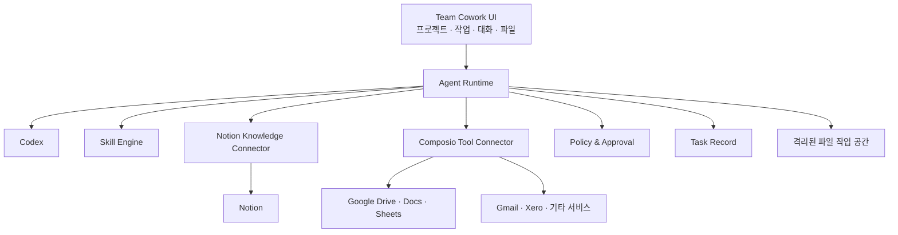

# Team Cowork 제품 설계

- 작성일: 2026-07-27
- 상태: 브레인스토밍 승인 완료
- 문서 목적: 구현 계획을 작성하기 전에 제품 범위, 사용자 경험, 시스템 경계와 안전 정책을 확정한다.

## 1. 제품 정의

Team Cowork는 여러 사용자가 회사의 지식과 외부 서비스를 공유하면서도 개인별 대화와 작업 기록을 분리해 사용하는 업무 에이전트다.

핵심 에이전트는 Codex다. OAuth는 Codex를 사용하기 위한 인증 방식일 뿐 제품 기능이나 차별화 요소가 아니다. 제품은 Codex를 다음 요소와 결합해 팀 업무에 적합하게 만든다.

- Notion 기반 팀 지식베이스
- Composio 기반 외부 서비스 연결
- 반복 업무를 표준화하는 Skill
- 프로젝트와 작업 중심의 Cowork 사용자 경험
- 외부 작업에 대한 위험도 기반 승인
- 사용자별 대화, 파일 및 작업 기록 격리

제품의 초기 판매 및 검증 대상은 회계사무소지만, Cowork 자체는 업종에 종속되지 않는 범용 플랫폼으로 설계한다. 회계사무소용 기능은 첫 번째 Skill Pack으로 제공한다.

## 2. 제품 목표

사용자가 AI 도구의 설정, 프롬프트 작성, 외부 서비스 연동 방식을 학습하지 않아도 실제 업무를 안전하게 완료할 수 있게 한다.

사용자는 다음을 할 수 있어야 한다.

1. 프로젝트 안에서 자연어로 작업을 요청한다.
2. 팀의 Notion 지식과 연결된 외부 서비스를 사용한다.
3. Google Docs, Google Sheets와 로컬 Excel 파일을 함께 다룬다.
4. Codex가 제안한 계획과 작업 진행상태를 확인한다.
5. 위험한 외부 작업을 실행 전에 검토하고 승인한다.
6. 반복 업무를 대화와 업무 시연으로 Skill로 만든다.
7. 검증된 Skill을 관리자의 승인 후 팀에 배포한다.
8. 개인 결과 중 필요한 결과만 프로젝트와 Notion에 공유한다.

## 3. 설계 원칙

### 3.1 Codex 단일 에이전트

초기 제품은 Codex 하나를 핵심 에이전트로 사용한다. Hermes, 역할별 다중 에이전트, 별도 오케스트레이션 에이전트는 사용하지 않는다.

### 3.2 Skill 중심 실행

일반적인 대화도 지원하지만 반복 업무는 Skill로 표준화한다. Skill은 단순 프롬프트가 아니라 입력, 실행 절차, 허용 도구, 결과 형식, 승인 정책과 예외처리를 포함하는 버전 관리된 업무 명세다.

### 3.3 공유와 개인 영역 분리

팀 지식, 승인된 Skill과 팀 연결은 공유한다. 개인 대화, 작업 중간 과정, 개인 첨부 파일과 미완성 결과는 사용자별로 격리한다.

### 3.4 Notion은 지식베이스

Notion은 회사 지식, 정책, SOP, 고객 정보와 확정된 결과를 저장한다. 모든 작업 파일을 Notion에 올리도록 강제하지 않는다.

### 3.5 원본 보존과 명시적 승인

파일 수정은 원본을 보존하고 새 버전을 만든다. 외부 발송, 삭제, 공유, 회계 데이터 변경 등 위험한 작업은 사용자 승인 후 실행한다.

### 3.6 초기 범위 최소화

첫 버전은 웹 기반 Team Cowork와 실제 업무 실행을 검증한다. 운영사 관리 플랫폼, 과금, 데스크톱 앱, 자체 지식베이스와 다중 에이전트는 포함하지 않는다.

여기서 제외하는 운영사 관리 플랫폼은 여러 고객사 테넌트, 과금과 모델 사용량을 중앙에서 운영하는 별도 시스템을 뜻한다. 한 고객사 내부에서 사용자, 프로젝트, Skill과 연결 권한을 관리하는 Team Admin 기능은 MVP에 포함한다.

## 4. 전체 시스템 구조

### 4.1 Team Cowork UI

사용자가 프로젝트와 작업을 만들고 Codex와 대화하며 파일, 계획, 승인 요청과 결과를 확인하는 웹 애플리케이션이다.

### 4.2 Agent Runtime

별도의 AI 모델이 아니라 Codex를 Team Cowork 제품으로 감싸는 애플리케이션 계층이다.

- 사용자별 Codex 세션 관리
- 현재 작업에 필요한 컨텍스트 구성
- Skill 버전 고정과 실행 조율
- Notion 및 Composio 도구 제공
- 정책과 승인 적용
- 진행상태와 실행 기록 저장

### 4.3 Skill Engine

Skill의 생성, 테스트, 승인, 배포, 실행, 버전 복구와 비활성화를 관리한다.

### 4.4 Notion Knowledge Connector

현재 사용자와 프로젝트가 접근할 수 있는 Notion 지식만 검색해 Codex에 전달한다. 작업 결과는 사용자가 명시적으로 선택한 경우에만 Notion에 반영한다.

### 4.5 Composio Tool Connector

Google Drive, Docs, Sheets, Gmail, Xero 등 외부 서비스의 인증과 도구 호출을 제공한다. 개인 연결과 팀 연결을 구분한다.

### 4.6 Policy & Approval

도구와 작업의 위험도를 평가해 자동 실행, 미리보기 또는 사용자 승인을 결정한다.

### 4.7 Task Record

사용한 Skill 버전, 실행 단계, 도구 호출, 승인, 외부 변경, 파일과 결과를 작업 단위로 기록한다.

## 5. 사용자 경험

### 5.1 Home

- 내 진행 중 작업
- 승인이 필요한 작업
- 최근 완료된 작업
- 새로 배포된 팀 Skill
- 추천 업무와 빠른 실행
- 새 작업을 시작하는 자연어 입력창

### 5.2 Projects

고객, 부서 또는 업무 영역별 공동 공간이다.

- 프로젝트에 게시된 결과와 파일
- 관련 Notion 지식
- 프로젝트에서 사용할 수 있는 Skill
- 허용된 Composio 연결
- 프로젝트 구성원

개인 대화는 프로젝트에 자동 공유되지 않는다.

### 5.3 Tasks

하나의 실제 업무를 처음부터 결과까지 관리한다.

- 작업 목표와 요청
- Codex와의 개인 대화
- 입력 파일
- 실행 계획과 진행상태
- 참조한 Notion 지식
- 실행한 Skill과 버전
- Composio 작업과 승인
- 중간 결과와 최종 산출물

완료 후 사용자는 결과를 개인 보관, 프로젝트 게시 또는 Notion 반영 중에서 선택한다.

### 5.4 Skill Studio

- 대화로 Skill 생성
- 기존 업무 시연을 Skill로 변환
- 예시 입력 및 좋은 결과물 첨부
- 테스트와 단계별 미리보기
- 개인 초안 관리
- 관리자 승인 요청
- 팀 배포와 버전 복구
- 프로젝트, 데이터와 도구 접근 범위 설정

### 5.5 Approvals

승인이 필요한 작업을 한곳에서 보여준다.

- 실행하려는 작업과 이유
- 대상 서비스와 계정
- 변경 전후 미리보기
- 영향받는 데이터와 파일
- 사용된 Skill과 버전
- 승인, 거절 또는 수정 요청

## 6. 정보 구조와 격리

기본 정보 구조는 `팀 → 프로젝트 → 작업 → 대화`다.

### 6.1 팀 공유 영역

- 승인 및 배포된 Skill
- 공유 Notion 지식
- 팀이 허용한 Composio 연결
- 프로젝트에 게시된 결과

### 6.2 사용자 개인 영역

- 개인 대화
- 작업 중간 과정
- 개인 첨부 파일
- 미완성 결과물
- Skill 개인 초안

관리자는 개인 대화 원문을 기본적으로 볼 수 없다. 보안 감사에는 대화 원문 대신 도구 실행, 승인과 외부 변경 사실을 제공한다.

## 7. 사용자 역할과 권한

### 7.1 Member

- 개인 작업 생성 및 실행
- 배포된 팀 Skill 사용
- 허용된 외부 연결 사용
- 결과를 프로젝트에 게시

### 7.2 Skill Creator

Member 권한에 다음을 추가한다.

- Skill 개인 초안 생성 및 수정
- 테스트 실행
- 팀 배포 승인 요청

### 7.3 Team Admin

- 팀 사용자 및 프로젝트 권한 관리
- 프로젝트별 Notion 및 Composio 접근 설정
- Skill 검토, 승인, 배포, 복구와 비활성화
- 팀 연결 관리

한 사용자는 여러 역할을 가질 수 있다.

## 8. Skill 설계

### 8.1 Skill 생성 방식

Skill은 대화형 생성과 실제 업무 시연을 결합한 하이브리드 방식으로 만든다.

1. 사용자가 자연어로 업무 목표를 설명한다.
2. Skill Builder가 입력, 데이터, 도구, 단계, 결과와 승인 조건을 질문한다.
3. 사용자가 기존 문서, Excel 또는 좋은 결과물 예시를 첨부한다.
4. 필요하면 사용자가 실제 업무를 한 번 수행해 시연한다.
5. Codex가 실행 가능한 Skill 초안을 생성한다.
6. 사용자가 자연어로 초안을 수정한다.
7. 테스트 후 관리자에게 팀 배포 승인을 요청한다.

### 8.2 Skill 구성

각 Skill은 다음 정보를 가진다.

- 이름과 설명
- 소유자와 공개 범위
- 사용 조건
- 입력 규칙
- 실행 단계
- Notion 검색 지침
- 허용된 Composio 도구
- 파일 처리 지침
- 출력 형식
- 승인 정책
- 예외 처리
- 테스트 사례
- 버전과 변경 이력

### 8.3 Skill 상태

`개인 초안 → 테스트 완료 → 승인 요청 → 관리자 검토 → 팀 배포`

배포된 Skill 버전은 직접 수정하지 않는다. 변경하면 새 초안 버전을 만들며, 진행 중인 작업은 시작할 때 고정된 Skill 버전을 계속 사용한다.

### 8.4 Skill 테스트

1. 구조 검사: 입력, 도구 권한과 승인 정책을 검사한다.
2. 미리보기 실행: 외부 시스템을 변경하지 않고 계획과 예상 결과를 보여준다.
3. 제한 실행: 테스트 데이터 또는 지정된 범위에서 실제 실행한다.

관리자는 테스트 결과와 외부 영향 범위를 확인한 뒤 배포한다.

## 9. 작업 실행 흐름

### 9.1 요청

사용자는 작업 목표, 첨부 파일, 사용할 문서와 원하는 결과를 입력한다. Skill을 선택하지 않으면 Codex가 적합한 팀 Skill을 추천하거나 일반 작업으로 처리한다.

### 9.2 계획

Codex가 실행 계획을 만들고 단계별 데이터 소스, 도구와 승인 필요 여부를 표시한다.

### 9.3 컨텍스트 구성

Agent Runtime은 다음 정보만 현재 Codex 작업에 제공한다.

- 사용자와 팀의 필요한 식별 정보
- 프로젝트 권한과 정보
- 현재 작업의 대화
- 고정된 Skill 버전
- 관련 Notion 페이지
- 첨부 파일의 격리된 작업 경로
- 허용된 Composio 도구

다른 사용자의 개인 대화와 작업은 제공하지 않는다.

### 9.4 실행

Codex가 Skill 절차에 따라 Notion 지식 검색, Google 문서 조회, 파일 분석, 결과 생성과 Composio 도구 호출을 수행한다.

### 9.5 승인

위험한 외부 작업이 발생하면 실행을 일시 정지하고 사용자에게 변경 내용을 보여준다. 승인 후 같은 Task Run을 이어서 실행한다.

### 9.6 완료

최종 결과와 실행 요약을 제공한다. 사용자가 프로젝트 게시 또는 Notion 반영 범위를 선택한다.

## 10. 파일과 데이터 처리

### 10.1 Notion

Notion은 지식베이스로 사용한다. 정책, SOP, 고객 정보와 확정된 지식을 검색하고 선택적으로 갱신한다.

### 10.2 Google Docs와 Google Sheets

Composio를 통해 검색, 조회, 생성과 수정을 수행한다. 변경 작업은 기본적으로 복사본을 생성하거나 승인 후 원본에 반영한다.

### 10.3 로컬 Excel

웹 MVP에서는 로컬 파일을 작업에 업로드한다.

1. 작업별 격리 공간에 원본을 저장한다.
2. Codex가 파일을 분석하거나 수정한다.
3. 원본을 보존하고 수정본을 새 버전으로 만든다.
4. 변경 내용을 미리 보여준다.
5. 사용자가 다운로드하거나 Google Drive 및 프로젝트에 공유한다.
6. 요약 또는 확정된 정보만 선택적으로 Notion에 반영한다.

로컬 폴더를 직접 읽고 수정하는 데스크톱 연결 기능은 후속 버전으로 둔다.

## 11. 위험도 기반 승인

### 11.1 자동 실행

- 지식과 데이터 검색
- 읽기 전용 조회
- 개인 작업 공간의 초안 생성
- 외부에 영향을 주지 않는 분석

### 11.2 정책에 따른 실행

- 되돌릴 수 있는 내부 문서 수정
- 새 문서 또는 복사본 생성
- 프로젝트 내부 게시

팀 정책에 따라 자동 실행 또는 승인을 선택할 수 있다.

### 11.3 항상 승인

- 이메일과 메시지 발송
- 외부 공유
- 데이터 삭제
- 원본 파일 덮어쓰기
- 회계 및 결제 데이터 변경
- 권한 변경

Skill 테스트에서는 외부 변경을 기본적으로 차단한다.

## 12. 실패 처리

Task Run 상태는 다음과 같다.

`대기 → 계획 → 실행 → 승인 대기 → 완료 / 실패 / 취소`

- 단계별 결과를 저장해 중단 후 이어서 실행한다.
- 일시적 외부 오류는 제한된 횟수만 자동 재시도한다.
- 중복 이메일 발송과 데이터 변경을 막기 위해 작업별 실행 키를 사용한다.
- 실패 시 완료된 단계, 실패 지점과 이미 발생한 외부 변경을 표시한다.
- 일부 성공한 작업에는 복구 또는 재실행 계획을 제시한다.
- 취소해도 이미 발생한 외부 작업은 별도로 표시한다.

## 13. 보안

### 13.1 파일

- 작업별 격리된 파일 공간
- 파일 형식, 크기와 악성 콘텐츠 검사
- Excel 매크로와 실행 파일 기본 차단
- 원본 보존과 수정본 버전 관리
- 보존 정책에 따른 임시 파일 삭제

### 13.2 외부 연결

- 최소 권한 연결
- 인증정보와 토큰을 Codex 컨텍스트에 직접 노출하지 않음
- Skill과 프로젝트가 허용한 도구만 호출
- 개인 연결과 팀 연결 분리

### 13.3 프롬프트 인젝션 방어

Notion, 이메일, 문서와 파일의 내용은 신뢰할 수 없는 데이터로 취급한다. 외부 콘텐츠는 시스템 정책, 팀 정책, 승인된 Skill 또는 사용자 권한을 변경할 수 없다.

지시 우선순위는 다음과 같다.

`시스템 정책 → 팀 정책 → 승인된 Skill → 사용자 요청 → 외부 콘텐츠`

## 14. 감사 기록

다음 실행 사실을 기록한다.

- 실행 사용자와 시각
- 프로젝트와 작업
- 사용한 Skill과 버전
- 접근한 데이터 소스
- 호출한 Composio 도구
- 외부 변경 전후 요약
- 승인 요청, 결정과 승인자
- 생성 또는 수정된 파일
- 실패, 재시도와 재개 이력

개인 채팅 원문은 감사 기록과 분리한다.

## 15. MVP 범위

### 15.1 포함

- 팀과 사용자 로그인
- Member, Skill Creator, Team Admin 역할
- 프로젝트, 작업과 개인 대화
- 사용자별 대화, 작업과 파일 격리
- Codex 기반 단일 에이전트
- Notion 지식 검색과 선택적 반영
- Composio 기반 Google Drive, Docs와 Sheets 연동
- 로컬 Excel 업로드, 분석, 수정과 다운로드
- 작업 계획과 진행상태
- 위험도 기반 승인
- 결과의 선택적 프로젝트 공유
- Skill 생성, 테스트, 승인, 배포와 버전 관리
- 실행 및 감사 기록

### 15.2 제외

- 운영사 멀티테넌트 관리 플랫폼
- 결제와 사용량 과금
- 데스크톱 앱과 로컬 폴더 직접 접근
- 다중 에이전트
- 자체 지식베이스와 벡터 DB
- 범용 대시보드 빌더
- 예약 및 이벤트 기반 자동 실행
- 모바일 앱
- Skill 마켓플레이스

## 16. 첫 회계사무소 Skill Pack

### 16.1 미수금 보고서

Google Sheets 또는 Excel을 분석하고 Notion의 고객 정책을 참조해 고객별 미수금 보고서와 이메일 초안을 만든다.

### 16.2 월 비용 정리

Excel 또는 영수증 자료를 분류 규칙에 따라 정리하고 검토용 결과 파일을 만든다.

### 16.3 주간 고객 업무 보고

Notion과 Google 문서의 변경 내용을 수집해 주간 요약과 후속 작업을 만들고, 승인 후 프로젝트에 게시한다.

## 17. 성공 기준

- 신규 사용자가 별도 교육 없이 첫 작업을 생성할 수 있다.
- 사용자가 대화와 예시 파일로 Skill 초안을 만들고 테스트할 수 있다.
- 동일 Skill의 반복 실행에서 필수 단계와 결과 형식이 유지된다.
- 다른 사용자의 개인 대화와 파일에 접근할 수 없다.
- 위험한 외부 작업은 승인 없이 실행되지 않는다.
- Google Sheets와 로컬 Excel을 같은 작업에서 처리할 수 있다.
- 실패한 작업의 원인과 이미 발생한 외부 변경을 확인할 수 있다.
- 회계사무소가 첫 Skill Pack 중 하나를 실제 주간 업무에 반복 사용한다.

## 18. 테스트 전략

- Skill 구조, 버전과 정책 단위 테스트
- Codex, Notion과 Composio를 대체한 통합 시뮬레이션
- 테스트 계정을 이용한 Google Docs 및 Sheets 실제 연동 테스트
- Excel 원본 보존, 수정본 정확성과 악성 파일 처리 테스트
- 사용자와 프로젝트 간 데이터 격리 테스트
- 승인 우회 및 프롬프트 인젝션 공격 테스트
- 외부 서비스 실패, 중복 요청, 중단 후 재개 테스트
- 회계사무소 사용자를 대상으로 한 실제 업무 시나리오 검증

## 19. 구현 계획 전 확정된 결정

- 범용 Team Cowork에 회계사무소용 첫 Skill Pack을 제공한다.
- 핵심 에이전트는 Codex 하나다.
- OAuth는 Codex 인증 세부사항으로만 취급한다.
- Notion은 공유 지식베이스다.
- Google 서비스와 기타 외부 서비스는 Composio로 연결한다.
- 로컬 Excel은 웹에서 업로드하고 수정본을 내려받는다.
- 대화와 작업 기록은 사용자별로 격리한다.
- Skill은 개인 초안, 테스트, 관리자 승인, 팀 배포 순서로 관리한다.
- 외부 작업에는 위험도 기반 승인 정책을 적용한다.
- 운영사 관리 플랫폼은 현재 범위에서 제외한다.
